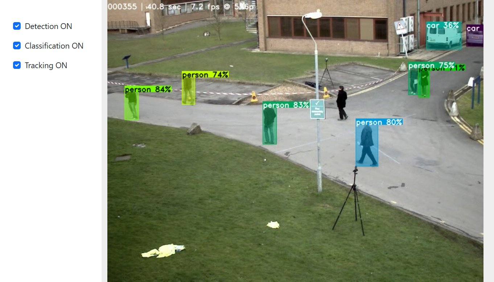

# DTC: Detection, Tracking, and Classification 



Working on this repo with a coding agent: `AGENTS.md` (rules, layout, testing ladder) and `.claude/skills/` (Pi access,
change loop, SOT benchmark, datasets, known issues).

## Setup
`tools/` is a git submodule (github.com/dryabokon/tools, pinned commit):
```
git clone --recursive https://github.com/dryabokon/DTC      # or, in an existing clone: git submodule update --init
```
DTC runs on two platforms from the same code:

| | Raspberry Pi 5 (ARM, CPU) | x86 laptop / PC (Windows, CUDA if present) |
|---|---|---|
| environment | `infrastructure/build_me_arm.sh` → `~/venv/p311_dtc` | `infrastructure\build_me_x86.bat` → `<repo>\.venv` (`DTC_VENV` to move it) |
| run by hand | `./app_run_pi.sh --source campus` | `app_run_x86.bat --source campus` (or `camera`), UI http://localhost:8509 |
| from the harness | `dtc pi start / stop / status / logs / open` | `dtc local start / stop / status / logs / open` |
| tests | `dtc test unit / smoke / integration / quality` | `dtc test unit / smoke / integration --local` → `runs/<suite>_x86/` |
| code that runs | the last commit (`dtc pi sync`) | the working tree |

Raspberry Pi: `python infrastructure/pi.py sync` puts the Pi's checkout and its `tools/` on this laptop's branch and commits
(from GitHub, or as git bundles over SSH when the Pi is offline). On the laptop, 8509 can be taken by the Pi tunnel
(`dtc pi open` behind a VPN) or by the Fly2 UI: start the local app with `--ui_port 8510` then.

## Harness: everyday operations
One command, `dtc` (`dtc.bat` on Windows, or `python dtc.py`). The Pi is found by itself (`.env`: `PI_HOST`, `PI_HOSTKEY`,
`PI_MACS`, `PI_USER`, `PI_PASSWORD`): at home, over a direct cable, on a phone hotspot.
```
dtc pi status                     where the Pi is, its commit vs the laptop's, is DTC running (source, fps, SOT)
dtc pi sync                       Pi -> this laptop's branch and commit
dtc pi start --source camera      start DTC on the Pi (any app flags), dtc pi stop / logs / open / run "<cmd>"
                                  cameras: camera = first USB camera (/dev/videoN), picam = embedded Camera Module (csi://0, picamera2)
dtc local start --source camera   the same on this laptop (x86): dtc local stop / status / logs / open
dtc up local [unreal]             (Unreal game +) DTC on this laptop;  dtc unreal local: DTC here on the running game stream
dtc sim start                     Fly2 camera simulator on this PC -> rtsp://<PC>:8554/sim (camera moved in the Fly2 UI :8509)
dtc sim pi                        DTC on the Pi on the simulator stream (drone detector ready)
dtc clips record NAME --maneuver yaw|yaw_fast|sweep|none --seconds 60     reference clip -> clips/NAME
```

## Web UI keys
Click / drag on the video: track a box (SOT) · right click, Esc, C: stop tracking · Esc Esc (twice quickly, any tab): quit the app ·
Space: pause / resume (video files) · ->: next frame while paused · R / Home / ⏮: video from the start · H: hide the panel.
Click-to-track model: the "Click-to-track" dropdown in the panel, or `--sot_tracking_model NANO|VIT|SIAMBAN|SIAMFC|MIL`
(default NANO; `--sot_score_th X` overrides the per-model loss threshold). Details and Pi timings: `utils_tracker_sot.SOT_MODELS`,
comparison: the web UI's **Benchmark** tab (preset, models, videos, objects per video; readiness, estimate, progress, cancel)
and **Runs** tab (runs/bench/NNNN on the Pi: precision / recall / F1 / fps per model, F1 per video, recall and precision
Gantt charts per video, a hit / miss clip per video and model); same from the laptop:
`dtc bench run --preset quick|standard|full [--models ...] [--seqs ...] [--objects N]`, `dtc bench list | pull [NNNN|all] | cancel`.
Live video holds while nobody watches it (`--idle_pause_s`, default 5 s) and while a benchmark runs.
Behind a full-tunnel VPN (Windows blocked, WSL not) the harness reaches the Pi through WSL; `dtc pi open` gives the UI on
http://localhost:8509.

## Labeling (Label tab)
Ground truth for ONE object per frame, from any video file. The video list (a thumbnail per video - a project shows its
first key frame with the box; type to filter, or a path + Enter; + Upload - it lands in `datasets/videos/uploads/<name>/`,
never overwriting; copying a file to `datasets/videos/<set>/<name>/` by hand works too) also deletes: the bin on a row,
after a question in the row, moves a label project or an uploaded video to `datasets/.trash/<time>_<name>/` (move it back
to undo) and only hides a video of `images/` or of a dataset (the files stay; "N hidden - show" brings it back). Draw a box -> the
click-to-track tracker (model picked in the tab, default = `sot_tracking_model`) follows it as fast as it goes and
stops by itself when the loss rules fire, at the next key frame or at the end. Wrong box: step back (<- ->, or the mouse wheel over the frame / timeline; Shift: 10 frames),
draw it again - a new key frame; what was tracked after it (up to the next key frame) is dropped and tracking restarts there.
Back-tracking: a box drawn on a frame is first tracked backwards over the run before it, down to where both runs agree
(3 frames in a row); the frames above that, where the run had left the object, get the backward boxes - so draw where the
error is plain to see (often the frame where it stopped), no need to scroll back to where it began. The line under the
frame says which frames it fixed. Ctrl+Z undoes it together with the run. Tracked boxes and the labeled part of the timeline are
orange; a key frame is red - its box, and a small red mark above the timeline. Delete all (next to Delete) asks first in a small pop-up; Ctrl+Z brings the labels back,
and the gt.jsonl as it was stays as `gt.before_delete_all.jsonl` in the clip folder.
Every action is a button in the toolbar under the frame (icon + caption; hovering it shows its key and what it does; greyed
out when it cannot act on this frame), so the whole job can be done with the mouse. The keys:
Space: track / stop · Esc / right click: stop · Shift+drag: a key frame without tracking · K: this box is right, make it a
key frame (the tracked frames after it stay) · N: no object on this frame only, the frames after it stay (Shift+N: up to the next key frame) ·
Del: delete from here - this frame's box and what the tracker made after it, up to your next key frame (a frame without
a label reads as "no object" in the benchmark, so no single holes) · Ctrl+Z: undo (a tracking run is one step; kept until the app restarts) ·
P: play the labels at the video's speed to review them. Keys go by the physical key (any keyboard layout). An occlusion: delete from the
first bad frame, draw the box again where the object is back (the frames between stay empty = "no object").
Besides the app's loss rules the tracker stops (the line under the frame says why; the cursor lands there) where its box jumps away from where it
was heading (> 0.3 box heights in one frame, > 0.35 over two: swaps to another person) and where a run arrives at a key
frame far from its box (IoU < 0.3: it followed an occluder on the way). A swap while two people cross slowly is not
caught, nor a box that slowly grows over two or three people (seen on a drone video of a basketball court), nor a box
that stays on something still (a sign) while the object walks on: "Same
object?" in the panel shows the box of this frame next to the key frame's - check it, or review with P. A jump can be
the box coming back after a passer-by: look a frame or two back too. A reopened project continues at its last
labeled frame. The jump rule fits people and cars seen from a steady camera; on a small target with a jerky camera (the
thermal drone sequence `drone_ir`) it also stops on true motion - press Track to go on.
The video is decoded once into `runs/labels/<name>/frames/` (<= 1280 px wide; the frame numbers are cv2's, as in the
benchmark). Every change is saved to `clips/<name>/` (`video.mp4`, `gt.jsonl` = `{"frame", "box" in source px | null, "src":
manual|track|interp|absent}`, `label.json`): it is a benchmark sequence (`clip:<name>`) at once; opening the same video again
resumes it (if the source video is gone, from the clip's own `video.mp4`). Frames never labeled are not written (= no object). Code: `src/utils_label.py`, `src/static/label.js`.

## Tests
```
dtc test unit          tests/unit on the Pi (unittest, seconds)
dtc test smoke         ~1 min, before every push: unit + start, frames, SOT click/Esc, detection on, clean exit
dtc test integration   ~2 min: CLI, sources (file, 1080p, dead URL, camera), SOT, Esc; --sim: PC simulator + drone MOT
dtc test smoke --local   the same on this laptop (x86 venv, working tree) -> runs/smoke_x86/ (also unit, integration)
dtc test quality       ~6 min (Pi only): metrics with limits vs the previous run - SOT loss detection (PETS ground truth),
                       SOT on reference clips (clips/), app FPS per mode
dtc runs               latest runs and verdicts;   dtc report [suite] [NNNN]
```
Every run writes `runs/<suite>/NNNN/`: `report.md` (checks, metrics vs previous run), `metrics.json`, `manifest.json`
(laptop / tools / Pi commits, dirty flag, command, times, verdict), `log.txt`, and the Pi artifacts (`pi/`: app log,
df_time / df_track, video). Interactive app sessions go to `runs/sessions/NNNN/` on the Pi.
Thresholds live in `harness/suites.py` (`LIMITS`). The tests run the last **commit** on the Pi, not uncommitted changes.

Reference clips (`clips/<name>/video.mp4 + gt.jsonl + meta.json`, exact target box per frame from Fly2) are local only,
not in git; `dtc test quality` copies new ones to the Pi.
