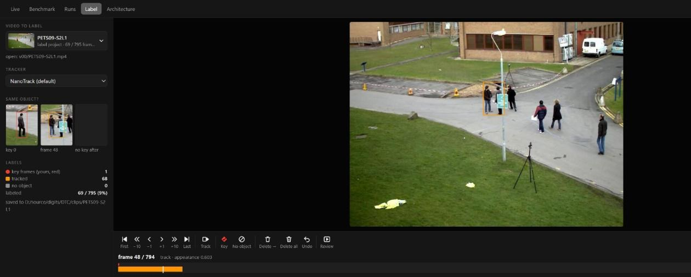

# DTC: Detection, Tracking, Classification

Video in (file, USB / CSI camera, RTSP) → YOLO detection, DeepSORT tracking, click-to-track → web UI on http://localhost:8509.
Runs on a Raspberry Pi 5 (CPU) and on a Windows PC (CUDA if present) from the same code.


## What you can do

| tab | |
|---|---|
| **Live** | watch the source, turn on detection / tracking, click or drag on an object to follow it (Esc stops) |
| **Label** | make ground truth for one object in any video: draw a box once, the tracker does the rest |
| **Benchmark** | compare click-to-track models (NANO, VIT, SIAMBAN, SIAMFC, MIL) on labeled videos |
| **Runs** | benchmark results: precision / recall / F1 / fps, per-video charts, hit / miss clips |

## Labeling in 30 seconds



1. **Label** tab → pick a video (or **+ Upload**).
2. Draw a box around the object. The tracker follows it frame by frame (orange) until it loses it.
3. Where it went wrong, draw the box again: that frame becomes a **key frame** (red), tracking restarts from it,
   and the frames before it are fixed by tracking backwards.
4. **P** plays the result back. Done: everything is already saved.

| key | | key | |
|---|---|---|---|
| ← → / wheel | previous / next frame (Shift: 10) | Space | track / stop |
| N | no object on this frame | Del | delete from here to the next key frame |
| K | this tracked box is right: key frame | Ctrl+Z | undo |

Every button under the frame does the same with the mouse. The result is `clips/<name>/gt.jsonl`
(one line per frame: box in source pixels, or `null` = no object) and is at once a benchmark video `clip:<name>`.

## Run

```
git clone --recursive https://github.com/dryabokon/DTC
infrastructure\build_me_x86.bat            # Windows; Pi: infrastructure/build_me_arm.sh
app_run_x86.bat --source campus            # or --source camera / a file / rtsp://...; Pi: ./app_run_pi.sh
```

Any setting in `src/configs/config_common.py` is also a flag (`--name value`).
The `dtc` command drives the app, the Pi and the tests (`dtc local start`, `dtc pi start`, `dtc test smoke`, `dtc bench run`):
see the docstring in `dtc.py`. Working on the code (with or without a coding agent): `AGENTS.md`.
